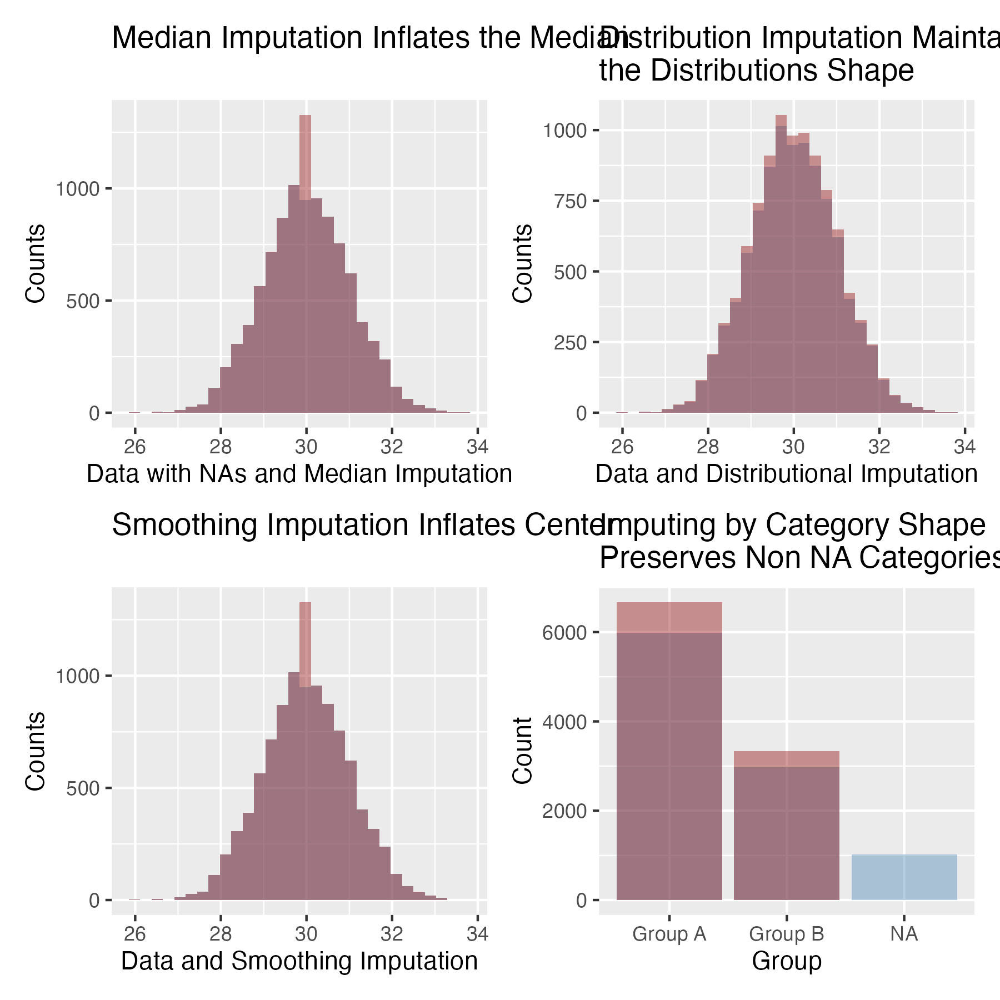

README.md
================
Keith Chamberlain
2026-11-08

# README

Demonstrating and documenting the helper functions in this repo. 1. (if
not installed) installing and loading a vector of package names. 1.
Univariate imputation procedures for comparison

``` r
source("Imputation.R")
source("LoadingPackages.R")

packages <- c("ggplot2", "patchwork")
N <- 10000

# (If not installed) Install and Load Packages
installed <- install_missing_packages(packages)
loaded <- load_packages(packages)
```

# Create Data

Create data for methods

``` r
data <- rnorm(n=10000, mean=30, sd=1)
data_nas <- sample(x=c(data, rep(NA, 400)), size=N, replace = TRUE)
data_categorical <- sample(x=c("Group A", "Group B", NA), size=N,
                           prob=c(0.6, 0.3, 0.1), replace=TRUE)
times <- 1:N

print("Number of NAs in data")
```

    ## [1] "Number of NAs in data"

``` r
sum(is.na(data_nas))
```

    ## [1] 392

``` r
print("Number of NAs in categorical")
```

    ## [1] "Number of NAs in categorical"

``` r
sum(is.na(data_categorical))
```

    ## [1] 980

# Imputation Fun

Demonstrate imputation procedures that improve upon imputation by mean
or median values. 1. fill by median value 1. fill by sampling from a
distribution 1. fill by smoothing using lm 1. fill by sampling from non
NA categories

For impute.distribution, `...` passes the specified distribution
function parameters such as the mean, sd, sigma, etc.

``` r
data_fill_median <- impute.fun(data_nas, fun=median)
data_fill_nas_distribution <- impute.distribution(
    y=data_nas, distribution=rnorm, mean=mean(data_nas, na.rm=TRUE),
    sd=sd(data_nas, na.rm=TRUE))
data_fill_nas_smooth <- impute.lm.smooth(y=data_nas, x=times, degree=2)
data_fill_nas_categorical <- impute.categorical(y=data_categorical)

print("Number of NAs in data after fill by fun")
```

    ## [1] "Number of NAs in data after fill by fun"

``` r
sum(is.na(data_fill_median))
```

    ## [1] 0

``` r
print("Number of NAs in data after fill by distribution")
```

    ## [1] "Number of NAs in data after fill by distribution"

``` r
sum(is.na(data_fill_nas_distribution))
```

    ## [1] 0

``` r
print("Number of NAs in data after fill by smooth")
```

    ## [1] "Number of NAs in data after fill by smooth"

``` r
sum(is.na(data_fill_nas_smooth))
```

    ## [1] 0

``` r
print("Number of NAs in data after fill by category")
```

    ## [1] "Number of NAs in data after fill by category"

``` r
sum(is.na(data_fill_nas_categorical))
```

    ## [1] 0

# Visualization

View distribution before/after imputation

``` r
dat <- data.frame(nas=data_nas, nas_cat=data_categorical,
                  median=data_fill_median, distrib=data_fill_nas_distribution,
                  smooth=data_fill_nas_smooth, cat=data_fill_nas_categorical)

pltmedian <- ggplot(data=dat) +
    geom_histogram(fill="steelblue", alpha=0.4, aes(x=nas), bins=30) +
    geom_histogram(fill="darkred", alpha=0.4, aes(x=median), bins=30) +
    labs(x="Data with NAs and Median Imputation", y="Counts",
         title="Median Imputation Inflates the Median")

pltsmooth <-  ggplot(data=dat) +
    geom_histogram(fill="steelblue", alpha=0.4 ,aes(x=nas), bins=30) +
    geom_histogram(fill="darkred", alpha=0.4, aes(x=smooth), bins=30) +
    labs(x="Data and Smoothing Imputation", y="Counts", 
         title="Smoothing Imputation Inflates Center")

pltdistrib <- ggplot(data=dat) +
    geom_histogram(fill="steelblue", alpha=0.4 ,aes(x=nas), bins=30) +
    geom_histogram(fill="darkred", alpha=0.4, aes(x=distrib), bins=30) +
    labs(x="Data and Distributional Imputation", y="Counts", 
         title="Distribution Imputation Maintains\nthe Distributions Shape")

pltcats <- ggplot(data=dat) +
    geom_bar(aes(x=nas_cat), stat="count", alpha=0.4, fill="steelblue") +
    geom_bar(aes(x=cat), stat="count", alpha=0.4, fill="darkred") +
    labs(x="Group", y="Count",
         title="Imputing by Category Shape\nPreserves Non NA Categories")
    
(pltmedian + pltdistrib) / (pltsmooth + pltcats)

```

    ## Warning: Removed 392 rows containing non-finite outside the scale range (`stat_bin()`).
    ## Removed 392 rows containing non-finite outside the scale range (`stat_bin()`).
    ## Removed 392 rows containing non-finite outside the scale range (`stat_bin()`).

<!-- -->
